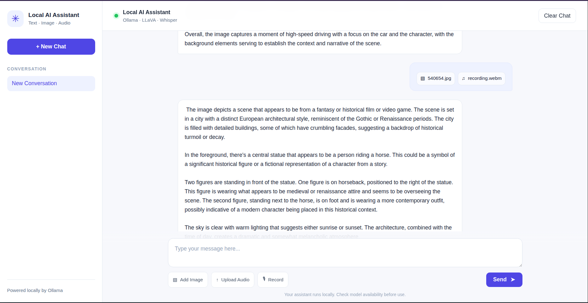
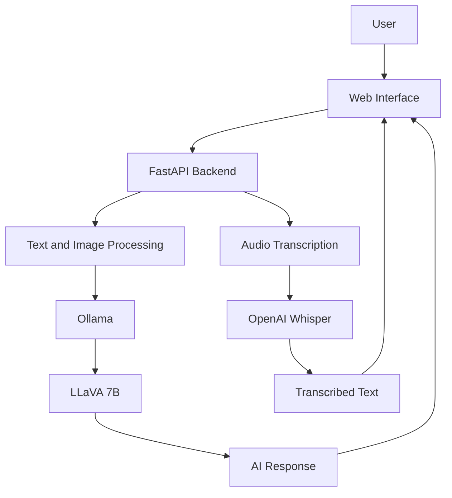

<div align="center">

# localmind-multimodal-ai

### A Local-First Multimodal AI Assistant for Text, Vision, and Audio

*Master's in Artificial Intelligence and Emerging Technologies (MIATE)*  
*Faculty of Applied Sciences, Nador (FSA Nador) — Mohammed First University*

<br/>


</div>

---

## Table of Contents

- [1. Project Overview](#1-project-overview)
- [2. Objectives](#2-objectives)
- [3. Main Features](#3-main-features)
- [4. Application Screenshots](#4-application-screenshots)
- [5. System Architecture](#5-system-architecture)
- [6. Technologies Used](#6-technologies-used)
- [7. Repository Structure](#7-repository-structure)
- [8. Prerequisites](#8-prerequisites)
- [9. Installation and Execution](#9-installation-and-execution)
- [10. Security and Privacy](#10-security-and-privacy)
- [11. Roadmap](#11-roadmap)
- [12. Limitations](#12-limitations)
- [13. Author](#13-author)
- [14. License](#14-license)

---

## 1. Project Overview

**localmind-multimodal-ai** is a multimodal AI assistant designed to run locally and bring text interaction, image understanding, and audio input together in a single web application.

Developed with Python and FastAPI, the application integrates Ollama for local model execution, LLaVA for vision-language tasks, and OpenAI Whisper for speech transcription.

The project explores how computer vision and speech recognition can be integrated into an interactive AI application while reducing reliance on external model-hosting services.

The interface allows users to communicate with the assistant, upload images for analysis, and provide audio for transcription and processing.

This is an ongoing academic project, with further work planned on security, conversation management, persistent memory, and multimodal reliability.

---

## 2. Objectives

The main objectives of this project are:

- Develop a web application that combines text, image, and audio inputs.
- Explore image understanding using a vision-language model.
- Integrate local AI inference through Ollama.
- Process audio input using speech recognition.
- Build an interactive interface with attachment previews and loading indicators.
- Explore the privacy implications and security challenges of local AI applications.
- Provide a foundation for future multimodal AI features.

---

## 3. Main Features

### 3.1. Text Chat
Interact with the AI assistant through a conversational web interface.
- Submit text prompts.
- Receive responses from a locally hosted model.
- Display messages in a chat-style layout.
- Show loading indicators during processing.

### 3.2. Image Analysis
Upload an image and ask questions about its content using LLaVA.
- Image upload and preview.
- Visual question answering.
- Image-based interaction with the AI model.
- Attachment management before submission.

### 3.3. Audio Input
Use audio recordings as input for speech transcription.
- Upload audio files.
- Record voice through the interface, where supported.
- Transcribe speech using Whisper.
- Integrate transcription into the application's processing workflow.

### 3.4. Interactive Web Interface
The frontend provides a single interface for the supported input types.
- HTML, CSS, and JavaScript.
- Jinja2 templates.
- Attachment previews and removal.
- Loading indicators and chat-style presentation.

### 3.5. Local AI Inference
Ollama runs the configured vision-language model locally. Whisper handles speech transcription through the application's audio service. Local inference can reduce the need to send prompts to a remote model provider, although overall privacy also depends on the application's implementation and configuration.

---

## 4. Application Screenshots

### 4.1. Main Interface
<p align="center">
  
</p>

### 4.2. Text Chat
<p align="center">
  
</p>

### 4.3. Image Analysis
<p align="center">
  
</p>

### 4.4. Audio Input
<p align="center">
  
</p>

---

## 5. System Architecture

The application follows a web-based architecture in which the frontend communicates with a FastAPI backend. The backend directs supported requests to the relevant AI component.



### Processing Pipeline

| Stage | Description |
|---|---|
| **Input** | User submits text, an image, or audio |
| **Backend** | FastAPI receives the request |
| **Task processing** | The application selects the relevant processing service |
| **AI inference** | Ollama/LLaVA processes supported text and image tasks |
| **Speech recognition** | Whisper transcribes audio |
| **Output** | The interface displays the response or transcription |

*The diagram presents the main components at a high level. The exact flow depends on the request type and the implemented backend logic.*

---

## 6. Technologies Used

| Technology | Role |
|---|---|
| **Python** | Main programming language |
| **FastAPI** | Backend framework |
| **HTML5 / CSS3 / JavaScript** | Web page structure, styling, and interactions |
| **Jinja2** | HTML templating |
| **Ollama** | Local AI model runtime |
| **LLaVA 7B** | Vision-language model |
| **OpenAI Whisper** | Speech recognition |
| **FFmpeg** | Audio processing support, where required |
| **Uvicorn** | ASGI server |

---

## 7. Repository Structure

```text
localmind-multimodal-ai/
│
├── app.py
├── requirements.txt
├── .gitignore
├── .env.example
├── project.md
├── README.md
│
├── services/
│   ├── __init__.py
│   └── transcription_service.py
│
├── static/
│   ├── script.js
│   └── style.css
│
├── templates/
│   └── index.html
│
└── docs/
    └── images/
        ├── localmind-preview.png
        ├── text-chat.png
        ├── image-analysis.png
        └── audio-input.png
```

---

## 8. Prerequisites

Before running the project, make sure you have:

- Python 3.10 or later, compatible with the project dependencies.
- Ollama installed and running.
- The LLaVA model downloaded.
- FFmpeg installed if required by the audio processing service.
- A modern web browser.
- Sufficient memory, storage, and processing resources for local model inference.

*Resource requirements depend on the selected model and the available hardware.*

---

## 9. Installation and Execution

### 9.1. Clone the Repository
```bash
git clone https://github.com/mohammed-boujaada/localmind-multimodal-ai.git
cd localmind-multimodal-ai
```

### 9.2. Create a Virtual Environment
On Linux or macOS:
```bash
python3 -m venv .venv
source .venv/bin/activate
```
On Windows PowerShell:
```powershell
python -m venv .venv
.\.venv\Scripts\Activate.ps1
```

### 9.3. Install Dependencies
```bash
python -m pip install --upgrade pip
pip install -r requirements.txt
```
*Install FFmpeg separately if it is required and is not already available on your system.*

### 9.4. Download the AI Model
Install Ollama from its official website: https://ollama.com/

Download LLaVA:
```bash
ollama pull llava:7b
```
Check that the model is available:
```bash
ollama list
```
*Make sure Ollama is running before launching the application.*

### 9.5. Run the Application
Start the FastAPI server with Uvicorn:
```bash
uvicorn app:app --reload
```
Open the following address in your browser:  
**http://127.0.0.1:8000**

*The development server is intended for local development. Do not expose it directly to untrusted networks.*

---

## 10. Security and Privacy

Running models locally can reduce reliance on external AI APIs, but it does not automatically make an application secure. The following areas require attention as the project develops:

- Validate uploaded files and enforce size limits.
- Handle temporary files safely.
- Review endpoint security and access to local services.
- Evaluate prompt injection through text, images, and audio.
- Improve error handling and logging.
- Add automated security tests.
- Document privacy-related settings and data retention.

*These points form part of the project's planned security improvements.*

---

## 11. Roadmap

The following items represent planned improvements rather than confirmed existing features.

### Security and AI Security
- [ ] Validate uploaded files and enforce file-size limits.
- [ ] Improve temporary-file handling.
- [ ] Review application endpoint security.
- [ ] Evaluate prompt injection risks.
- [ ] Add automated security tests.

### Conversation Management
- [ ] Support multiple independent conversations.
- [ ] Store conversation history.
- [ ] Create, switch between, rename, and delete conversations.

### Persistent Memory
- [ ] Implement long-term memory.
- [ ] Separate conversation context from saved memories.
- [ ] Allow users to inspect, edit, and delete saved memories.
- [ ] Add memory retention controls.

### Multimodal Improvements
- [ ] Improve combined text, image, and audio workflows.
- [ ] Improve transcription and error handling.
- [ ] Explore additional local models.
- [ ] Evaluate response quality and resource usage.

### Testing and Reliability
- [ ] Add automated backend tests.
- [ ] Test multimodal request combinations.
- [ ] Add security regression tests.
- [ ] Improve setup and troubleshooting documentation.

---

## 12. Limitations

- AI responses depend on model quality and configuration.
- Image analysis may produce incorrect or incomplete interpretations.
- Transcription quality depends on audio clarity, background noise, and language.
- Local models may require substantial memory and processing resources.
- Some combinations of text, image, and audio may require further integration.
- Persistent memory and advanced conversation management remain planned improvements.

*The project is intended for academic experimentation. Outputs should be reviewed rather than treated as guaranteed correct.*

---

## 13. Author

<div align="center">

<table>
<tr>
<td align="center" width="280">
<a href="https://github.com/mohammed-boujaada">

<br/>
<sub><b>Mohammed Boujaada</b></sub>
</a>
<br/>
MIATE Master's, FSA Nador
<br/><br/>
<a href="https://github.com/mohammed-boujaada">

</a>
<br/>
<a href="https://www.linkedin.com/in/mohammed-boujaada-229a3333a/">

</a>
</td>
</tr>
</table>

<br/>

| | |
|---|---|
| **Institution** | FSA Nador, Master's in Artificial Intelligence and Emerging Technologies |
| **Module** | Computer Vision |
| **Academic Year** | 2025 - 2026 |

</div>

---

## 14. License

No license has been selected for this repository yet. A license should be added once the contributors have decided on the terms for distribution and reuse.

---

<div align="center">

**localmind-multimodal-ai — Bringing Text, Vision, and Audio Together**

</div>


