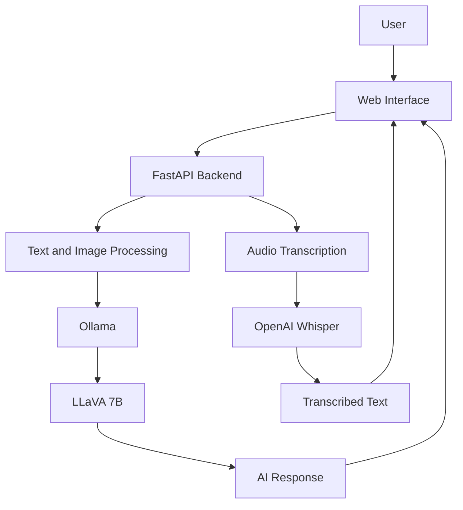

# LocalMind AI

### A Local-First Multimodal AI Assistant for Text, Vision, and Audio

[](https://www.python.org/)
[](https://fastapi.tiangolo.com/)
[](https://ollama.com/)
[](https://llava-vl.github.io/)
[](https://github.com/openai/whisper)
[](https://developer.mozilla.org/en-US/docs/Web/JavaScript)
[](https://developer.mozilla.org/en-US/docs/Web/HTML)
[](https://developer.mozilla.org/en-US/docs/Web/CSS)
[](https://jinja.palletsprojects.com/)
[]()

**Academic Program:** Master's in Artificial Intelligence and Emerging Technologies (MIATE)  
**Institution:** Faculty of Applied Sciences, Nador (FSA Nador), Mohammed First University, Morocco

**Author:** [Mohammed Boujaada](https://github.com/mohammed-boujaada)  
**Collaborative Repository:** [moza369/localmind-ai](https://github.com/moza369/localmind-ai)

---

## Table of Contents

- [1. Project Overview](#1-project-overview)
- [2. Objectives](#2-objectives)
- [3. Main Features](#3-main-features)
- [4. Application Screenshots](#4-application-screenshots)
- [5. System Architecture](#5-system-architecture)
- [6. Technologies Used](#6-technologies-used)
- [7. Repository Structure](#7-repository-structure)
- [8. Prerequisites](#8-prerequisites)
- [9. Installation and Execution](#9-installation-and-execution)
- [10. Security and Privacy](#10-security-and-privacy)
- [11. Roadmap](#11-roadmap)
- [12. Limitations](#12-limitations)
- [13. Contributors](#13-contributors)
- [14. License](#14-license)

---

## 1. Project Overview

**LocalMind AI** is a local-first multimodal AI assistant designed to bring text interaction, image understanding, and audio transcription together in a single web application.

Developed with Python and FastAPI, the application integrates Ollama for local model execution, LLaVA for vision-language tasks, and OpenAI Whisper for speech transcription.

The project explores how different AI capabilities can be combined in one interactive application while reducing reliance on externally hosted AI services.

Users can interact with the assistant through text prompts, upload images for analysis, and provide audio recordings for transcription. The web interface brings these interactions together in a single environment.

LocalMind AI is an academic project that also explores the practical challenges of building local AI applications, including model resource requirements, file handling, privacy, and multimodal reliability.

## 2. Objectives

The main objectives of LocalMind AI are:

- Develop a web application that supports text, image, and audio inputs.
- Integrate a vision-language model for image understanding.
- Run supported AI models locally through Ollama.
- Process audio recordings using speech recognition.
- Build an interactive interface with attachment previews and loading indicators.
- Explore privacy and security considerations in local AI applications.
- Establish a foundation for future conversation management and persistent memory.

## 3. Main Features

### 3.1. Text Chat

The application provides a conversational interface for interacting with a locally hosted AI model.

- Submit text prompts.
- Receive model-generated responses.
- Display messages in a chat-style layout.
- Show loading indicators while requests are being processed.

### 3.2. Image Analysis

LocalMind AI integrates LLaVA to support visual question answering and image-based interactions.

- Upload images through the web interface.
- Preview attachments before submission.
- Ask questions about image content.
- Process image-related prompts through the configured vision-language model.

### 3.3. Audio Input and Transcription

The application uses Whisper for speech recognition.

- Upload supported audio files.
- Record voice through the interface where supported.
- Transcribe audio into text.
- Integrate the transcription into the application's processing workflow.

### 3.4. Interactive Web Interface

The frontend combines the supported input types in one interface.

- HTML5 and CSS3 for structure and styling.
- JavaScript for client-side interactions.
- Jinja2 for server-rendered templates.
- Attachment previews and removal.
- Loading indicators and chat-style presentation.

### 3.5. Local Model Execution

Ollama provides the local inference runtime for the configured LLaVA model.

Running models locally can reduce the need to send prompts to remote model-hosting services. Actual privacy guarantees depend on application behavior, configuration, and how data is handled.

## 4. Application Screenshots

The following images illustrate the intended locations for the application's interface screenshots. Keep the filenames synchronized with the actual files in the repository.

### 4.1. Main Interface

<p align="center">
  
</p>

### 4.2. Text Chat

<p align="center">
  
</p>

### 4.3. Image Analysis

<p align="center">
  
</p>

### 4.4. Audio Input

<p align="center">
  
</p>

## 5. System Architecture

LocalMind AI follows a web-based architecture in which the frontend communicates with a FastAPI backend. The backend routes requests to the appropriate AI component according to the task.



### Processing Pipeline

| Stage | Description |
|---|---|
| Input | User submits text, an image, or audio |
| Backend | FastAPI receives the request |
| Task processing | The application selects the appropriate processing component |
| AI inference | Ollama and LLaVA handle supported text and image tasks |
| Speech recognition | Whisper converts supported audio into text |
| Output | The interface displays the response or transcription |

The diagram represents the high-level architecture. The precise processing flow depends on the implemented backend logic and request type.

## 6. Technologies Used

| Technology | Role |
|---|---|
| Python | Main programming language |
| FastAPI | Backend web framework |
| Uvicorn | ASGI server |
| HTML5 | Web interface structure |
| CSS3 | Interface styling |
| JavaScript | Frontend interactions |
| Jinja2 | Server-side HTML templating |
| Ollama | Local AI inference runtime |
| LLaVA 7B | Vision-language model |
| OpenAI Whisper | Speech recognition |
| FFmpeg | Audio processing support, where required |

## 7. Repository Structure

```text
localmind-ai/
│
├── app.py
├── requirements.txt
├── .gitignore
├── .env.example
├── project.md
├── README.md
│
├── services/
│   ├── __init__.py
│   └── transcription_service.py
│
├── static/
│   ├── script.js
│   └── style.css
│
├── templates/
│   └── index.html
│
└── docs/
    └── images/
        ├── localmind-preview.png
        ├── text-chat.png
        ├── image-analysis.png
        └── audio-input.png
```

## 8. Prerequisites

Before running LocalMind AI, make sure you have:

- Python 3.10 or a compatible version supported by the project's dependencies.
- Ollama installed and running.
- The required LLaVA model downloaded.
- FFmpeg installed if required by the audio processing implementation.
- A modern web browser.
- Sufficient memory, storage, and processing resources for local inference.

The resources required depend on the selected model, its configuration, and the available hardware.

## 9. Installation and Execution

### 9.1. Clone the Repository

```bash
git clone https://github.com/moza369/localmind-ai.git
cd localmind-ai
```

### 9.2. Create a Virtual Environment

**Windows PowerShell**

```powershell
python -m venv .venv
.\.venv\Scripts\Activate.ps1
```

**Linux or macOS**

```bash
python3 -m venv .venv
source .venv/bin/activate
```

### 9.3. Install Dependencies

```bash
python -m pip install --upgrade pip
pip install -r requirements.txt
```

Install FFmpeg separately if the audio service requires it and it is not already available on your system.

### 9.4. Install and Download the AI Model

Install Ollama from its official website:

[https://ollama.com/](https://ollama.com/)

Download the LLaVA 7B model:

```bash
ollama pull llava:7b
```

Check the available models:

```bash
ollama list
```

Make sure Ollama is running before launching the application.

### 9.5. Start the Application

Run the FastAPI application using Uvicorn:

```bash
uvicorn app:app --reload
```

Open the application in your browser:

[http://127.0.0.1:8000](http://127.0.0.1:8000)

The command assumes that `app.py` exposes a FastAPI instance named `app`. The development server is intended for local development; additional configuration is required for production deployment.

## 10. Security and Privacy

Local execution can reduce reliance on external AI services, but it does not automatically guarantee complete privacy or application security.

Important considerations include:

- **File validation:** Validate uploaded files and enforce file-size limits.
- **Temporary files:** Handle temporary audio and image files safely.
- **Endpoint security:** Review access to backend endpoints and local services.
- **Prompt injection:** Evaluate risks from instructions embedded in text, images, and other inputs.
- **Error handling:** Avoid exposing sensitive information in error messages and logs.
- **Data retention:** Define how uploaded files and conversation data are stored and deleted.
- **Network exposure:** Avoid exposing development services directly to untrusted networks.

These considerations should guide future security improvements and testing.

## 11. Roadmap

The following items are planned improvements and should not be interpreted as features that are already implemented.

### Security and AI Safety

- Strengthen upload validation and file-size restrictions.
- Improve temporary-file handling.
- Review endpoint access controls.
- Evaluate multimodal prompt injection.
- Add automated security tests.

### Conversation Management

- Support multiple independent conversations.
- Store and retrieve conversation history.
- Create, rename, switch between, and delete conversations.

### Persistent Memory

- Explore persistent memory across conversations.
- Separate short-term conversation context from saved information.
- Allow users to inspect, update, and delete saved memories.
- Introduce configurable retention controls.

### Multimodal Improvements

- Improve text, image, and audio integration.
- Improve transcription error handling.
- Explore additional local models.
- Evaluate response quality and resource consumption.

### Testing and Reliability

- Add automated backend tests.
- Test different combinations of multimodal inputs.
- Improve error reporting and troubleshooting documentation.
- Evaluate performance across different hardware configurations.

## 12. Limitations

- Response quality depends on the selected model and its configuration.
- Image analysis may produce inaccurate or incomplete descriptions.
- Transcription quality depends on audio clarity, background noise, and language.
- Local inference may require substantial memory and processing resources.
- Multimodal workflows may need additional integration and testing.
- Persistent memory and advanced conversation management are planned improvements rather than guaranteed existing features.

LocalMind AI is an academic project intended for experimentation. Its outputs should be reviewed, particularly when accuracy or reliability is important.

## 13. Contributors

LocalMind AI is developed in the context of the Master's program in Artificial Intelligence and Emerging Technologies (MIATE).

### Mohammed Boujaada

<p align="center">
  <a href="https://github.com/mohammed-boujaada">
    
  </a>
  <br>
  <strong>Mohammed Boujaada</strong>
  <br>
  <a href="https://github.com/mohammed-boujaada">GitHub</a> |
  <a href="https://www.linkedin.com/in/mohammed-boujaada-229a3333a/">LinkedIn</a>
</p>

### Academic Information

| Field | Details |
|---|---|
| Program | Master's in Artificial Intelligence and Emerging Technologies (MIATE) |
| Institution | Faculty of Applied Sciences, Nador (FSA Nador) |
| University | Mohammed First University, Morocco |
| Project | LocalMind AI |
| Academic Year | 2026–2027 |

**Collaborative repository:** [moza369/localmind-ai](https://github.com/moza369/localmind-ai)

Additional contributor information can be added here if you want to display your teammate's name and profile.

## 14. License

No license has been specified in this README. Before distributing or allowing reuse of the project, choose an appropriate license and add the corresponding `LICENSE` file to the repository.

---

<p align="center">
  <strong>LocalMind AI</strong>
  <br>
  A local-first approach to multimodal artificial intelligence.
</p>
